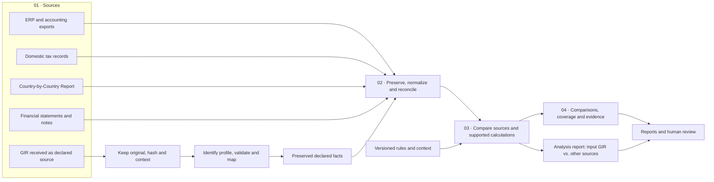

# Open Pillar Two Framework

OECD Minimum Tax Implementation (Pillar Two).

**Language / Idioma:** [English (US)](README.en.md) · [Português (Brasil)](README.md)

The [project presentation](https://amarallr.github.io/oecd_p2/apresentacao.html) provides a visual overview of the platform, its architecture and development stages.

**[Browse nine bilingual figures from the OECD Handbook →](https://amarallr.github.io/oecd_p2/figuras-pilar-dois.html)** · [documentation and source limits](sources/handbook-pilar-dois.md)

`oecd_p2` is an open-source project in development to model, calculate, explain and review global minimum taxation. Its initial policy cutoff is **October 23, 2026**. The RStudio project and explanatory website are implemented; the tax engine, national packages and real-world filing support are not. The project is not institutionally endorsed.

## Project goal

The long-term goal is an open, auditable and reusable foundation for Pillar Two/GloBE implementation and analysis. It connects accounting, tax, corporate-structure and filing data, preserving the origin of every value and the rules applied.

The **GloBE Information Return (GIR)** is an input source alongside ERP exports, domestic tax records, Country-by-Country Reporting (CbC), and financial documents. The workflow follows four stages:

1. **Sources:** preserve and identify the GIR and other authorized inputs.
2. **Preparation:** normalize, reconcile and compare compatible concepts while retaining provenance and coverage gaps.
3. **Core:** deepen the comparison between declared GIR values and independent sources; recalculate only when rules, profiles and inputs provide sufficient support.
4. **Results and use:** provide a report comparing the input GIR with other sources, including findings, differences, limitations, calculation memory and evidence for human review. **The platform will not produce an output GIR.**

Declared, normalized and recalculated values remain separate. Structural XML validation does not establish tax correctness or institutional acceptance. Receiving a local file does not connect this project to the OECD or a tax authority.

These capabilities are specified, not implemented. There is no GIR XML importer, XSD validation, analysis-report engine, GloBE engine or institutional receipt channel. Output GIR generation is out of scope. The synthetic JSON example is an internal design contract, not an official GIR fixture.

## Project documentation

| ID | Document | Language |
|---|---|---|
| P00 | [Project charter](docs/P00-carta.md) | Portuguese |
| P01 | [Common contract](docs/P01-contrato.md) | Portuguese |
| P04 | [Data and accounting](docs/P04-dados.md) | Portuguese |
| P07 | [Architecture and setup](docs/P07-arquitetura.md) | Portuguese |
| P08 | [Validation](docs/P08-validacao.md) | Portuguese |
| P10 | [Roadmap](docs/P10-roadmap.md) | Portuguese |
| P12 | [Comparative analysis of the input GIR](docs/en/P12-gir-input-review.md) · [official source notes](docs/en/gir-sources.md) | English (US) |
| Prompts | [Numerically ordered work-prompt index](prompts/README.en.md) | English index; prompts in Portuguese |

## Current status and next step

Available today: project documentation, synthetic contract examples, a static explanatory site, an interactive presentation, and a didactic calculator. No real tax calculation or integration is supported. The next proposed GIR increment is [GIR-1](prompts/execucao-GIR1.md), which first requires selecting a specific supported profile and legally available schema files.

Open issues include fixed XSD/dependency hashes, reviewed field mappings, domestic receipt requirements and parser resource limits. See the [GIR source notes](sources/gir.md) and [support matrix](docs/suporte.md). The project stores only synthetic examples; real tax returns must remain in an authorized environment.

## Run the explanatory site

Run `node scripts/servir-site.cjs` and open `http://127.0.0.1:8000/oecd_p2/`. The presentation is available at `http://127.0.0.1:8000/oecd_p2/apresentacao.html`. Node 18.19.1 or later is sufficient; no packages need to be installed.

Checks: `node scripts/verificar-projeto.cjs --web`, `node tests/site.test.cjs`, and `node tests/gir-design.test.cjs`. Passing these checks does not validate real tax obligations or GIR XML schemas.

Repository: [amarallr/oecd_p2](https://github.com/amarallr/oecd_p2). See [contribution](CONTRIBUTING.md), [governance](GOVERNANCE.md), [security](SECURITY.md), and [license](LICENSE).
