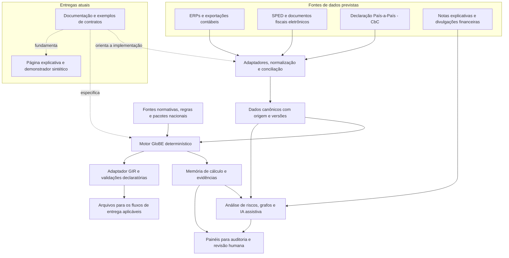

# Open Pillar Two Framework

OECD Minimum Tax Implementation (Pillar Two).

Para conhecer o projeto de forma visual e didática, a apresentação interativa explica o Pilar 2, o objetivo da plataforma, sua arquitetura e as etapas de desenvolvimento. Ela inclui navegação por slides, um exemplo de cálculo e a opção de salvar em PDF.

**[Abrir a apresentação do projeto →](https://amarallr.github.io/oecd_p2/apresentacao.html)**

`oecd_p2` é uma infraestrutura aberta em desenvolvimento para modelar, calcular, explicar e revisar tributação mínima global. O corte normativo inicial é **23/10/2026**. O projeto RStudio e a página explicativa estão implementados; o motor e os pacotes nacionais ainda não foram implementados. Não há suporte a obrigações tributárias reais nem endosso institucional.

## O que é o Pilar 2 da OCDE?

O Pilar 2 integra a iniciativa da OCDE e do G20 para enfrentar desafios da tributação internacional. Seu componente GloBE (*Global Anti-Base Erosion Rules*), foco deste projeto, estabelece uma tributação efetiva mínima de **15% por jurisdição** para grandes grupos multinacionais. A ideia é reduzir o incentivo para deslocar lucros a locais com baixa tributação. Veja a [introdução da OCDE ao imposto mínimo global](https://www.oecd.org/en/topics/sub-issues/global-minimum-tax.html).

No escopo geral das regras GloBE, entram grupos com receita consolidada anual de pelo menos **€ 750 milhões em dois dos quatro exercícios anteriores**, observadas as exclusões previstas. O critério considera a receita do grupo, e não apenas a de uma subsidiária. A [administração tributária canadense explica esse critério de enquadramento](https://www.canada.ca/en/services/taxes/excise-taxes-duties-and-levies/global-minimum-tax/about.html).

Para entender o cálculo, imagine reunir, em cada jurisdição, os resultados e os tributos das entidades do grupo. A alíquota efetiva (*Effective Tax Rate*, ETR) relaciona os tributos cobertos ajustados ao lucro GloBE, apurado a partir da contabilidade com ajustes próprios. Por isso, conhecer a alíquota nominal do imposto local não basta. Se a ETR ficar abaixo de 15%, pode haver imposto complementar (*top-up tax*).

**Exemplo didático:** lucro GloBE de 100 e tributos cobertos ajustados de 10 resultam em ETR de 10%. A diferença para o mínimo é de 5 pontos percentuais. Com uma exclusão baseada em substância de 20, o lucro excedente é 80 e o complemento ilustrativo é `5% × 80 = 4`. O exemplo isola a mecânica básica; não inclui imposto complementar doméstico, ajustes adicionais ou regimes de simplificação. A [OCDE descreve a relação entre ETR, lucro excedente e complemento](https://www.oecd.org/en/topics/sub-issues/global-minimum-tax.html).

As regras coordenam quem pode cobrar esse complemento:

| Mecanismo | Função em termos simples |
|---|---|
| QDMTT — *Qualified Domestic Minimum Top-up Tax* | Permite à jurisdição do lucro cobrar um imposto complementar doméstico qualificado, com prioridade na coordenação GloBE. |
| IIR — *Income Inclusion Rule* | Atribui à entidade controladora a cobrança relativa a lucros de entidades do grupo com baixa tributação, conforme a cadeia de participação e as regras aplicáveis. |
| UTPR — *Undertaxed Profits Rule* | Funciona como mecanismo de retaguarda para o complemento que não tenha sido alcançado pela IIR, distribuído entre jurisdições habilitadas. |

A aplicação depende da legislação de cada jurisdição, do período, das exclusões, das eleições e dos *safe harbours* — mecanismos de simplificação sujeitos a condições. Consulte o [resumo das regras GloBE da OCDE](https://www.oecd.org/content/dam/oecd/en/topics/policy-sub-issues/global-minimum-tax/pillar-two-model-rules-in-a-nutshell.pdf) e o [catálogo de fontes e versões do projeto](sources/catalogo.md). O Pilar 2 também compreende a STTR (*Subject to Tax Rule*), tratada separadamente do motor GloBE neste projeto.

A **GIR — GloBE Information Return** reúne informações do grupo, cálculos e dados por jurisdição para a administração tributária. Sua preparação exige conciliar contabilidade, tributos, estrutura societária e regras aplicáveis. O intercâmbio tem um [schema XML publicado pela OCDE](https://www.oecd.org/en/publications/globe-information-return-pillar-two-xml-schema-october-2026_1552c9aa-en.html); a geração de um arquivo válido é uma etapa distinta da correção do cálculo e do cumprimento das exigências locais.

## Objetivo do projeto

O objetivo de longo prazo é desenvolver uma **Plataforma Nacional de Inteligência Tributária Internacional**, voltada à operacionalização, à fiscalização e à análise do Pilar 2/GloBE no contexto brasileiro. O Open Pillar Two Framework pretende oferecer uma base aberta, auditável e reutilizável para essa plataforma, conectando dados empresariais, apuração do imposto complementar e informações declaratórias.

A proposta responde a um problema concreto: a aplicação do Pilar 2 exige combinar dados contábeis, fiscais, societários e financeiros de várias jurisdições. Organizar essas informações, conferir sua consistência e preservar a origem de cada resultado são condições para automatizar cálculos e apoiar a revisão por contribuintes e Auditores-Fiscais. A experiência brasileira com o SPED e os documentos fiscais eletrônicos oferece um ponto de partida para planejar essa integração.

### Capacidades previstas

| Módulo | Objetivo |
|---|---|
| Integração com ERPs | Desenvolver adaptadores para exportações e interfaces de sistemas como SAP, Oracle, Microsoft e TOTVS, capturando balancetes, planos de contas, tributos correntes e diferidos, operações entre empresas do grupo e dados de consolidação. |
| Normalização e conciliação | Converter diferentes estruturas de origem em contratos comuns, compatíveis com os cálculos GloBE, mantendo a rastreabilidade até os registros contábeis e documentais. |
| Motor GloBE | Apurar lucro GloBE, tributos cobertos ajustados, ETR e imposto complementar; incorporar progressivamente QDMTT, IIR, UTPR, exclusões e *safe harbours*, com regras versionadas e memória de cálculo. |
| Preparação da GIR | Consolidar informações, validar consistência e gerar arquivos conforme o conteúdo e o schema exigidos. JSON pode servir aos contratos internos; outros formatos dependerão de requisitos específicos. |
| Integração com SPED e documentos fiscais | Planejar cruzamentos com ECD, ECF, NF-e, EFD-Contribuições e EFD-ICMS/IPI, conforme disponibilidade, autorização e pertinência de cada fonte, para conciliar informações domésticas e internacionais. |
| Processamento de CbC | Integrar o *Country-by-Country Reporting* (Declaração País-a-País) para analisar receitas, lucros, tributos, empregados, ativos e entidades por jurisdição, apoiando a avaliação de riscos e os cruzamentos com ERP, SPED e GIR. |
| Inteligência fiscal | Aplicar ciência de dados, aprendizado de máquina e análise de grafos ao mapeamento societário e à identificação de padrões atípicos. A leitura assistida de notas explicativas e divulgações financeiras poderá complementar a análise, com evidências para revisão humana. |
| Painéis para auditoria | Apresentar grupos multinacionais, ETRs por jurisdição, indicadores de risco, inconsistências e vínculos documentais, permitindo examinar como cada conclusão foi produzida. |

Essas capacidades devem apoiar a seleção e a análise de riscos, com decisões fiscais fundamentadas e revisão humana. O resultado esperado é reduzir retrabalho na preparação de dados e declarações, tornar os cálculos verificáveis e ampliar a capacidade de análise integrada da administração tributária.

### Como as partes do projeto se conectam

O diagrama apresenta a arquitetura pretendida da plataforma. O motor, os conectores e os recursos analíticos são capacidades futuras; a documentação, os exemplos de contratos e a página explicativa já estão disponíveis.

Em texto: ERP, SPED e CbC alimentariam uma camada comum de preparação e conciliação. O motor aplicaria regras versionadas a esses dados e produziria resultados rastreáveis, que serviriam à preparação da GIR e à revisão fiscal. A análise de riscos também utilizaria documentos financeiros e apoiaria os painéis de auditoria. A IA teria função assistiva; a apuração do imposto permaneceria determinística. A página atual explica essa proposta e demonstra um caso sintético.

### Caminho de implementação

O projeto começa pela especificação dos dados e por um motor determinístico local, com casos sintéticos e escopo delimitado. Conectores empresariais, integração com sistemas fiscais, geração da GIR e recursos de inteligência serão desenvolvidos por etapas. As escolhas iniciais estão descritas na [arquitetura](docs/P07-arquitetura.md) e no [roadmap](docs/P10-roadmap.md).

Em fases posteriores, requisitos de escala poderão justificar processamento distribuído e armazenamento analítico. Kafka, Spark, DuckDB, ClickHouse, Neo4j, FastAPI e ferramentas de IA em Python são possibilidades a avaliar conforme o problema de cada módulo. A proposta mantém o compromisso com código aberto, contratos interoperáveis, execução soberana e auditabilidade.

**Situação atual:** essa plataforma é a visão de evolução do projeto. Estão disponíveis a documentação de concepção, os exemplos de contratos e a página explicativa; o motor de cálculo e as integrações acima ainda não estão implementados. O nome da proposta não representa vínculo ou adoção institucional pela Receita Federal do Brasil.

## Documentos da concepção

| Etapa | Entrega | Dependências |
|---|---|---|
| P00 | [Carta do projeto](docs/P00-carta.md) | P01 |
| P01 | [Contrato comum](docs/P01-contrato.md) | Caderno v0.3 |
| P02 | [Corpus e temporalidade](docs/P02-corpus.md) | P00 e P01 |
| P03 | [Domínio e regras](docs/P03-dominio.md) | P02 |
| P04 | [Dados e contabilidade](docs/P04-dados.md) | P02 e P03 |
| P05 | [Motor e memória](docs/P05-motor.md) | P02 a P04 |
| P06 | [Pacotes nacionais](docs/P06-pacotes.md) | P02 a P05 |
| P07 | [Arquitetura e ambiente](docs/P07-arquitetura.md) | P02 a P06 |
| P08 | [Validação](docs/P08-validacao.md) | P03 a P07 e P11 |
| P09 | [Governança](docs/P09-governanca.md) | P00 a P08 |
| P11 | [Especificação da página](docs/P11-pagina.md) | P00 a P09 |
| P10 | [Roadmap e próximos prompts](docs/P10-roadmap.md) | P00 a P09 e P11 |

Consulte também [decisões e lacunas](docs/decisoes.md), [fontes verificadas](sources/catalogo.md), [cobertura](docs/suporte.md), [ambiente observado](docs/ambiente.md), [ADRs](docs/adr/README.md), [prompts de trabalho e fonte original](prompts/README.md) e [evidências da entrega](docs/entrega-concepcao.md).

## Situação técnica

A pasta contém especificações e exemplos de contrato, sem biblioteca de cálculo executável. O arquivo `oecd_p2.Rproj` está na raiz Git, com sessão limpa e UTF-8. Seu conteúdo anterior foi preservado em backup fora do repositório. O histórico remoto inicial foi preservado.

Repositório confirmado: [amarallr/oecd_p2](https://github.com/amarallr/oecd_p2), público, branch `main`. O acesso foi confirmado após a criação pelo proponente; o bloqueio inicial de consulta está resolvido. A [atualização do repositório](docs/github.md) registra a continuidade do histórico. A [página explicativa](https://amarallr.github.io/oecd_p2/) e a [apresentação do projeto](https://amarallr.github.io/oecd_p2/apresentacao.html) estão publicadas no GitHub Pages, com deployment e recursos verificados em 23/10/2026.

Abra `oecd_p2.Rproj` no RStudio ou use o terminal na raiz. Leia o [guia de preparação F0](docs/ambiente-F0.md). Node 18.19.1 ou superior executa as ferramentas atuais, sem instalar bibliotecas; a versão de referência fica em `.node-version`. O núcleo Python/Decimal permanece decisão de F1. Não há pacotes R dependentes de renv nesta fase.

## Página interativa

### Apresentação do projeto

A [apresentação publicada](https://amarallr.github.io/oecd_p2/apresentacao.html), com [fonte em HTML](site/apresentacao.html), reúne dez temas, com modo de slides, navegação por teclado, arquitetura selecionável e o exemplo interativo 100/10/20 → 4. Após iniciar o servidor abaixo, abra `http://127.0.0.1:8000/oecd_p2/apresentacao.html`. Use **Apresentar** para alternar o modo; setas, Home/End e Esc controlam os slides. **PDF** abre a impressão de todos os temas, inclusive quando apenas um slide está visível. A apresentação adapta-se ao celular e não exige bibliotecas externas.

### Execução da página

Execute `node scripts/servir-site.cjs` e abra `http://127.0.0.1:8000/oecd_p2/`. No Windows sem Node no PATH, use `powershell -File scripts/servir-site.ps1`. A página reúne conceitos, arquitetura, fluxo guiado, demonstrador 100/10/20 → 4, memória, roadmap e fontes. Veja [execução e publicação](docs/publicacao.md), [evidências de validação da página](docs/validacao-web.md) e [validação da apresentação](docs/validacao-apresentacao.md).

Verificações: `node scripts/verificar-projeto.cjs --web` e `node tests/site.test.cjs`. As actions de CI verificam os contratos e executam Chromium com capturas; seus resultados precisam ser consultados em cada run. Esses testes não validam obrigações tributárias reais.

## Participação e licença

Consulte [CONTRIBUTING](CONTRIBUTING.md), [GOVERNANCE](GOVERNANCE.md), [CODE_OF_CONDUCT](CODE_OF_CONDUCT.md) e [SECURITY](SECURITY.md). Exemplos utilizam somente dados sintéticos. O material original do projeto adota [Apache-2.0](LICENSE); materiais recebidos e de terceiros conservam seus direitos conforme [NOTICE](NOTICE). Não há parecer jurídico institucional ou licença de documentos normativos implícita.
