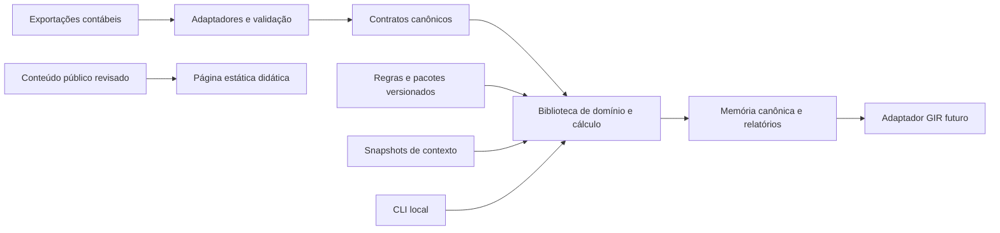

# Arquitetura e preparação do ambiente

A proposta inicial é um monólito modular usado como biblioteca e CLI. Evita operação distribuída no primeiro perfil e permite separar responsabilidades sem impor serviços. API, aplicação operacional e persistência multiusuário ficam para fases posteriores. A página explicativa é estática e independente do motor.

## Contexto e componentes

Visão C4 de contexto: preparador de dados fornece exportações contábeis; especialista seleciona contexto e interpretações revisadas; operador executa localmente; revisor recebe memória e insumos autorizados. Curadoria distribui versões de regras, sem receber dados dos usuários. Autoridades e fontes oficiais fundamentam corpus e pacotes, não são consultadas ao vivo para decidir um cálculo.

Visão C4 de contêineres proposta:

O equivalente textual é: adaptadores alimentam contratos; biblioteca recebe contratos, regras e snapshots; CLI invoca a biblioteca; memória alimenta relatórios e futuro adaptador GIR. A página usa conteúdo público e exemplo didático próprio, explicitamente limitado; não é requisito para executar a biblioteca.

| Módulo | Responsabilidade e fronteira |
|---|---|
| core/domain | Tipos, identidades, partições e invariantes |
| core/engine | Grafo determinístico e despacho por perfil |
| rules | Metadados, interpretações revisadas e aplicabilidade |
| jurisdictions | Manifestos e extensões nacionais ou fictícias |
| adapters | CSV/JSON, contabilidade, relatórios e futuro GIR |
| audit | Serialização canônica, hashes e memória |
| CLI | Validação de argumentos, códigos de saída e arquivos |
| storage | Arquivos imutáveis locais em F1; banco futuro mediante ADR |
| R | Exploração e relatórios opcionais; sem duplicação de regra fiscal |
| site | Conteúdo e interações públicas do P11 |

## Linguagem e contratos

| Opção | Decimal e tipos | Testes e portabilidade | Custo de manutenção |
|---|---|---|---|
| R | Numeric usual é binário; precisaria estratégia decimal específica | Integração natural no RStudio | Bom para análise; representação monetária precisa de contrato adicional |
| Python | Decimal na biblioteca padrão; tipos anotados com validação explícita | Biblioteca/CLI local e testes portáveis | Segunda linguagem no ambiente, com runtime a fixar |
| Java ou .NET | Tipagem estática e decimal/BigDecimal disponíveis | Ferramentas maduras; runtime adicional | Maior preparação e integração para o primeiro perfil |

**ADR-001 proposto:** núcleo Python com `decimal.Decimal`, modelos validados e JSON/CSV abertos. Escolha motivada pelo contrato decimal P05 e simplicidade da biblioteca/CLI; não implica Python instalado. Fixar versão suportada e ambiente virtual em F0/F1. As capacidades das alternativas que não foram avaliadas por protótipo deverão ser verificadas antes da adoção final. Integração no terminal RStudio: criar `.venv`, executar `python -m oecd_p2 ...` e testes; usar arquivos/CLI antes de adicionar uma ponte R. O namespace e comandos só existirão após F1.

Contratos públicos: `validate(input) -> diagnostics`; `calculate(context, data) -> result`; `explain(run) -> trace`; CLI futura `validate`, `calculate`, `explain`. Erros JSON incluem código, caminho do campo, regra, mensagem localizada e causa; saída 0 para comando bem-sucedido, 2 para entrada inválida, 3 para perfil não suportado/incompleto, 1 para falha interna. Não usar ausência de erro do processo como prova de obrigação concluída.

## Projeto e dependências

Raiz pretendida: `oecd_p2/`, com `.Rproj`, Git e módulos na mesma pasta. Já existe um `oecd_p2.Rproj` **no diretório-base**, junto de `.Rproj.user`. O bootstrap deve registrar essa situação, verificar que não haja outros arquivos relativos dependentes e consolidar a raiz escolhida preservando os originais e a sessão do usuário. Nesta rodada não foi movido nem duplicado o projeto.

Configuração especificada: RestoreWorkspace No, SaveWorkspace No, AlwaysSaveHistory No, Encoding UTF-8, SpacesForTab Yes e dois espaços. RStudio é ambiente solicitado; não é requisito de execução para terceiros. Para componentes R, `renv::init()`, snapshot e restore após revisão, com `renv.lock` e ativação versionados. Sem componente R executável nesta concepção, não gerar lock fictício nem inicializar biblioteca desnecessária. Para Python, `.venv` ignorado, versão declarada e lock de dependências quando houver dependências.

A estrutura futura segue o caderno: prompts, docs/adr, scripts, tests, examples, sources, schemas, core, rules, jurisdictions, adapters, R e site. Criar somente o necessário a cada fase. Bootstrap idempotente detecta arquivos e remoto, compara antes de alterar e conserva históricos.

## Segurança e operação

| Ameaça | Controle proposto | Evidência futura |
|---|---|---|
| Dados adulterados | Validação, reconciliação, proveniência e hash | Testes de corrupção e diagnóstico |
| Regras substituídas | Revisão, hashes, versões imutáveis e permissões | Comparação de versões e pacote assinado quando viável |
| Vazamento | ACL local, criptografia de disco, retenção definida pelo operador, logs sem valores sensíveis | Revisão de logs e configuração operacional |
| Dependência comprometida | Lock, revisão, SBOM e publicação rastreável | Artefato e inventário de dependências |
| Pacote com código malicioso | Origem confiável e revisão; declarativo por padrão | Rejeição de pacote desconhecido |
| XML malicioso | Sem entidades externas/DTD, limites de tamanho e profundidade | Testes do adaptador quando implementado |
| Acesso entre organizações | Segregação de armazenamento e credenciais | Gate obrigatório antes de qualquer serviço multiusuário |

F1 é local, com controle de acesso pelo sistema operacional; não promete autenticação ou multi tenancy implementada. Retenção e destruição dependem da política do operador e do direito aplicável. Relatórios seguem classificação de dados, sem publicação automática. Contêiner é opcional; não há cloud ou serviço comercial obrigatório.

Meta de engenharia proposta, ainda não medida: validar/canonizar/calcular 10 mil registros sintéticos do perfil simples em até 10 s e até 512 MiB em máquina de 4 núcleos/8 GiB. Medir cinco execuções após aquecimento, registrar runtime/hardware, mediana e pico de memória; não generalizar para todos os ajustes ou grupos. Build reproduzível depende também de runtime e plataforma fixados.

## GIR e página

Adaptador GIR separa conteúdo, XSD, intercâmbio e recepção interna. Seleção considera calendário do S6, destinatário e correções, não só exercício. Validar XML não comprova correção semântica nem aceitação pelo fisco.

Página: `site/index.html`, `site/assets/css/styles.css`, `site/assets/js/app.js`, dados locais opcionais. HTML/CSS/JS sem framework e sem backend; caminhos relativos. Preview futuro pelo terminal RStudio: `python -m http.server 8000 --directory site --bind 127.0.0.1`, após confirmar Python, e abrir `http://127.0.0.1:8000`. Não usar file:// como validação. GitHub Pages por workflow com artefato de site; confirmar configuração, deployment e URL real antes de publicar link no README.

## Fechamento

Fontes: S15/S16/S17 e P07; observações locais em [ambiente](ambiente.md). Decisões propostas: ADR-001 a ADR-004. Aceite arquitetural definido: biblioteca offline, contratos abertos, CLI e raiz única; prova por clone limpo, instalação e abertura efetiva no RStudio ficam para F0/F1.
