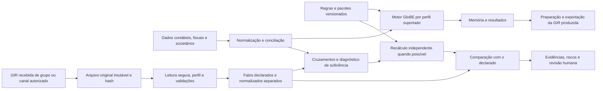

# P12 — GIR como entrada, saída e fonte de conferência

Versão: `0.1.0-design`, 23/10/2026. **Requisito incorporado à concepção; importador, validação XSD, conferência e motor ainda não implementados.** O exemplo JSON é contrato interno sintético, não GIR oficial nem fixture validada contra XSD. Fontes e lacunas: [catálogo GIR](../sources/gir.md). Decisão: [ADR-005](adr/ADR-005-gir-bidirecional.md).

## 1. Finalidade e fronteiras

A plataforma deve explicar o que o grupo declarou, em qual arquivo/versão/exercício, quais validações e cruzamentos foram executados, quais valores puderam ser recalculados e quais evidências ou dados faltam. Divergência é um resultado de conferência, não prova de infração. O núcleo permanece internacional; exigências brasileiras pertencem a adaptadores próprios.

| Fronteira | Contrato e limite |
|---|---|
| Recepção institucional | Entrega ou intercâmbio por canal autorizado, fora deste primeiro escopo; registrar evidência externa quando disponibilizada. Importar não confirma recepção ou aceitação fiscal. |
| Ingestão local | Operador disponibiliza arquivo autorizado; preservar bytes, identificar perfil, validar e mapear offline. Não conectar automaticamente à OCDE ou a fiscos. |
| Exportação | Produzir arquivo para um fluxo identificado; conteúdo, envelope de intercâmbio e requisitos domésticos têm versões e validações distintas. Exportar não transmite. |

Há duas jornadas complementares, ambas planejadas:

Em texto: a preparação usa dados empresariais para cálculo e exportação. A conferência parte da GIR recebida, preserva o original e produz fatos declarados separados das transformações. Só insumos suficientes e compatíveis permitem recálculo. O resultado nunca substitui silenciosamente a referência declarada. Não há obrigação de passar por um motor completo para preservar e validar um arquivo.

## 2. Requisitos verificáveis

| ID | Requisito | Evidência e bloqueio futuro |
|---|---|---|
| GIR-R01 | Separar recepção, ingestão e exportação; conteúdo, envelope e regra doméstica | Manifesto com finalidade e destinatário; sem alegar entrega por sucesso do parser |
| GIR-R02 | Original imutável, origem, hash SHA-256 dos bytes e data UTC de ingestão | Releitura com hash igual; original disponível mesmo após rejeição conforme retenção |
| GIR-R03 | Selecionar perfil por formato, namespace, versão, mensagem, contexto e fluxo | Perfil desconhecido: preservar e diagnosticar, sem processamento material ou fallback |
| GIR-R04 | Leitura XML segura e validações independentes de estrutura/semântica | DTD e entidades externas rejeitados; XSD local fixado, sem acesso à rede |
| GIR-R05 | Proveniência, cobertura e estados de ausência explícitos | Campo material não mapeado ou ausente bloqueia a conferência afetada; nunca vira zero |
| GIR-R06 | Separar declarado, normalizado e recalculado | Camadas imutáveis e cadeia de derivação; nenhuma circularidade |
| GIR-R07 | Comparar somente contextos conciliados e perfis suportados | Moeda/período/perímetro incompatível: `not_comparable`; insumo ausente: `insufficient_data` |
| GIR-R08 | Idempotência, histórico, correções e visão temporal explícitos | Reprocessamento sem duplicação; correção referenciada, não definida por upload recente |
| GIR-R09 | Diferenças exatas e tolerâncias versionadas | Valores preservados, sinal documentado, motivo de tolerância e evidências |
| GIR-R10 | Sigilo e isolamento por organização | Somente sintéticos no repositório/site; logs sem conteúdo fiscal; sem envio automático à IA |

São requisitos de produto e decisões de engenharia, fundamentados na necessidade informada pelo proponente e nos contratos P01/P04/P05/P07/P08; não se apresentam como campos ou comandos impostos pela OCDE. A matriz de casos desta especificação constitui critério de aceite futuro, não teste executado de um importador.

## 3. Perfil de processamento e pipeline

O manifesto de perfil terá `profile_id`, versão, `flow` (ingestão/exportação), versões de conteúdo, envelope e regra doméstica, formatos, namespaces/versões/mensagens aceitos, XSDs e dependências com hashes reais, parser/validador e limites, mapa de campos, regras semânticas e cobertura. Nenhum desses valores oficiais será inferido a partir da edição mais recente. Namespace pode identificar só a versão maior; não substitui a versão exata do arquivo e do XSD. Os perfis XML 1.0 e 2.0 são **candidatos não suportados**, sem namespace literal ou XSD fixado neste repositório.

| Etapa | Saída imutável ou diagnóstico | Condição para avançar |
|---|---|---|
| 1. Registrar origem e autorização | Evento de ingestão e classificação; canal declarado pelo operador | Autorização e política de armazenamento definidas; não inferir canal oficial |
| 2. Preservar bytes originais | `SourceDocument`, tamanho e SHA-256; quarentena quando necessário | Hash calculado dos bytes obtidos, sem alterar encoding ou quebras de linha |
| 3. Identificar formato e envelope | Tipo, namespace, versão, referências de origem e mensagem quando existentes | Inspeção limitada e segura; nunca carregar entidades para identificar o formato |
| 4. Selecionar perfil | ID/versão e motivos de seleção | Compatibilidade explícita; caso contrário `unsupported_profile` |
| 5. Ler com limites | Árvore ou eventos com localizadores estáveis | DTD/XXE desabilitados; tamanho, profundidade e recursos dentro do perfil |
| 6. Validar estrutura | `ValidationResult` com XSD e versão do validador | Schema pertinente, dependências locais e nenhuma busca de `schemaLocation` na rede |
| 7. Validar semântica e consistência | Resultados por regra e contexto | Separar erro bloqueante, alerta e verificação não executada |
| 8. Mapear e normalizar | `DeclaredFact`, `FieldMapping` e fatos normalizados derivados | Inventário de campos mapeados/não mapeados, materialidade e dependências |
| 9. Emitir cobertura | Perfil, regras executadas, erros, alertas e campos não cobertos | Só fatos com proveniência e aptidão explícitas alimentam verificações compatíveis |
| 10. Conciliar, recalcular e comparar | Resultados por escopo com snapshots de todas as entradas | Suficiência, independência e comparabilidade demonstradas |

Falha não apaga arquivo ou fatos já preservados. Não liberar uma conclusão global porque um subconjunto passou. A política pode admitir inspeção limitada de partes válidas, com diagnóstico e isolamento das partes bloqueadas. Arquivo fora do limite não é lido por completo pelo parser; sua preservação em quarentena depende da capacidade e da política autorizada do operador, com rejeição documentada quando impossível.

Proposta inicial de limites de engenharia para o piloto: 10 MiB por arquivo, profundidade 64, até 100 mil elementos, texto individual até 1 MiB, sem arquivos compactados; processo isolado com teto de memória e tempo a medir antes da liberação. São parâmetros de segurança **propostos**, configuráveis e versionados, não limites oficiais da GIR nem capacidade já aferida. Rejeitar DTD e declarações de entidades; desabilitar XInclude e resolução externa inclusive em XSDs; referências de schema só podem resolver em catálogo local autorizado. Não extrair XML com regex.

## 4. Contratos internos e integridade

Todos os nomes a seguir são internos. IDs são strings geradas no domínio do operador; identificadores oficiais, quando presentes, ficam em `source_identifiers` com tipo, valor e emissor. Não presumir correspondência entre um ID interno e um oficial. Todos os registros possuem `schema_version`, classificação (`synthetic` ou classe restrita do operador), proveniência, `recorded_at` UTC e versão imutável. Contextos de validade fiscal/mensagem ficam separados do instante de ingestão. O isolamento por organização faz parte das chaves de armazenamento e de todas as FKs.

| Entidade / chave | Cardinalidades | Obrigatórios além dos comuns | Opcionais ou condicionais | Integridade e temporalidade |
|---|---|---|---|---|
| Submission / `submission_id` | 1:N documentos por ligações; 1:N fatos e relações | `source_document_ids`, `context_state`, `processing_profile_state`, `source_identifiers` (lista possivelmente vazia) | Grupo, entidades, jurisdições, período, perfil, tipo de mensagem, evidência de recepção; desconhecidos com estado explícito | Não confundir um envelope com uma declaração integral. Contexto não identificado impede comparação, não preservação. Retificação cria novo registro. |
| SourceDocument / `document_id` | N:N Submission por ligação; 1:N proveniências | URI local autorizada, SHA-256 dos bytes, tamanho, origem, formato detectado/estado, classificação | Media type, encoding, namespace, versão, tipo de mensagem e referências externas, quando identificados | Bytes imutáveis; hash não prova autoria/aceitação. Reuso do conteúdo dentro da mesma organização mantém eventos de origem distintos. |
| DeclaredFact / `declared_fact_id` | N:1 Submission e documento; 1:N derivados normalizados | `concept_id`, `value_state`, original lexical ou motivo de ausência, localizador/contexto, escopo e materialidade | Valor decimal textual, moeda, unidade, escala, sinal, entidade/jurisdição/período quando informados | Não fabricar granularidade. Fato ausente usa referência ao requisito e ao contexto, sem inventar XPath de elemento existente. Nunca sobrescrever original. |
| FieldMapping / `mapping_id` | N:N localizadores/fatos e conceitos; derivados referenciam versão | Perfil, versão, seletor com namespaces, conceito-alvo, regra de transformação e estados aceitos | Pontes, agregação, referências normativas e exceções | Seletores XML só após revisão contra edição pertinente; cardinalidade/múltiplas ocorrências explícitas. Mudança gera nova versão e nova derivação. |
| ValidationResult / `validation_id` | N:1 documento/Submission; N:N fatos afetados | Camada (`structure`, `semantic`, `consistency`), regra/versão, estado, severidade, evidências e escopo | Valor observado/esperado, path, código de erro e limites | Estados `passed`, `failed`, `not_executed`, `unsupported`, `not_applicable`; não executado não é aprovado. Regra ausente impede pass. |
| ReconciliationResult / `reconciliation_id` | N:N fatos de fontes e normalizados | Chaves de ligação, fontes, pontes/versões, contexto, estado e evidências | Diferenças, taxas de câmbio e referências de ajustes | Perímetro, período, moeda e conceitos conciliados antes da comparação. Ausência de match não gera automaticamente diferença tributária. |
| RecalculationRun / `recalculation_run_id` | N:1 snapshot/contexto; N:N fatos/fontes; 1:N resultados | `input_snapshot`, origem dos insumos, perfil/regra/pacotes/versões, modo e estado | Hash canônico, saídas e trilha somente se executado; referências a Run de P04/P05 | `declared_arithmetic`, `gir_based` e `independent_sources` são modos distintos. Run não executado não recebe saída calculada ou hash fictício. |
| ComparisonResult / `comparison_id` | N:1 conferência/contexto e run; N:N fatos declarados | Regra, referências declaradas e de recálculo, contexto, completude, estado, independência e evidências | Valores comparáveis, diferenças, causas candidatas, tolerância | Valores não disponíveis permanecem null com motivo. Comparar não altera fontes. Novo run/correção exige nova comparação. |
| SubmissionRelation / `relation_id` | N:1 origem; 0..1 destino resolvido por relação; inversa 1:N | Tipo declarado, referência de origem, perfil, escopo afetado, estado | Submission/documento destino, referências de registro, evidência externa | Não resolver por horário do upload. Proibir ciclos e cruzamento de organizações; referência desconhecida fica pendente ou rejeitada conforme perfil. |

Os fatos normalizados referenciam `declared_fact_id`, `mapping_id` e versão, valor/unidade/escala originais e finais; são projeções separadas, não outra interpretação do valor original. Decimais seguem P04/P05: strings ASCII, sem float fiscal, até 30 dígitos e 10 casas no contrato inicial; conservar lexema e escala originais mesmo quando o valor exceder a capacidade, bloqueando conversão/cálculo em vez de arredondar silenciosamente. Taxas, moeda e convenção de sinal são explícitas.

`value_state`: `present`, `missing`, `unknown`, `not_applicable`. Somente `present` admite zero como valor. Nos demais, valor null e motivo obrigatório. Unidade, escala e moeda não são intercambiáveis. Um percentual textual não recebe interpretação automática de fração ou porcentagem.

Proveniência mínima de cada valor: Submission, documento/hash, localizador (XPath e tabela de namespaces quando XML; JSON Pointer na fixture interna), ocorrência e contexto, lexema original, transformação/versão e mapeamento/versão, entidade/jurisdição/período e seus estados de identificação. Quando o formato não fornece um componente, registrar ausência e consequência. Preservar proveniência de cada parcela de um agregado.

Idempotência proposta: conteúdo deduplicado por organização + hash dos bytes + tamanho (confirmar igualdade dos bytes em colisão); evento de recepção separado; processamento canônico por documento + contexto/Submission + perfil/validador/mapeamento e suas versões + configurações de segurança. Mesmos bytes de grupos/eventos distintos não unem declarações automaticamente. Repetir a mesma operação retorna os registros canônicos existentes e novo evento operacional, sem duplicar fatos. Outra versão produz nova execução, mantendo a anterior.

## 5. Camadas e independência

| Camada / modo | O que representa | O que não permite concluir |
|---|---|---|
| Declarado | Arquivo e valores atribuídos à declaração, sem alteração | Correção fiscal ou veracidade das bases |
| Normalizado | Valores derivados com mapeamento e transformações rastreáveis | Independência em relação à GIR |
| Aritmética declarada | Totais ou relações entre os próprios valores informados | Recálculo independente das bases |
| Recálculo com GIR | Execução com insumos provenientes da declaração | Confirmação externa da contabilidade ou de fatos não declarados |
| Recálculo independente | Execução com bases contábeis/fiscais externas conciliadas | Independência se as bases apenas copiarem a GIR |

Para chamar um recálculo de independente, registrar quais parcelas têm origem externa, suas conciliações e dependências compartilhadas com a GIR. Parcela insuficiente ou derivada da declaração limita a conclusão ao escopo efetivamente independente. Um futuro teste de dependências deve rejeitar referência circular a saídas do próprio run ou à comparação em suas entradas. Valores calculados não se tornam referência declarada; uma nova declaração externa exige novo arquivo e identificação de origem.

## 6. Conferências e cobertura por campo

Os grupos de campos abaixo são **conceitos candidatos**; seus XPaths, cardinalidades, condições e versões ainda não foram homologados. A disponibilidade deve ser conferida por documento/perfil, inclusive regimes simplificados. O inventário de cobertura registra campo/localizador, mapeamento, regra, materialidade, transformação, estado e razão de exclusão. Cobertura por contagem não autoriza ignorar um campo material.

| ID / finalidade | Insumos e fontes | Regra, agregação e aplicabilidade | Esperado / evidência / limitação |
|---|---|---|---|
| GIR-C01 Identificação | Grupo, entidades, jurisdições, exercício e IDs presentes na GIR; cadastro externo opcional | `identity_context_v1-design`; grupo/entidade/jurisdição/período identificáveis | Correspondências e conflitos documentados. Falta de granularidade → `insufficient_data`; não criar IDs oficiais. |
| GIR-C02 Contexto | Datas, moeda, unidade, escala e perímetro de cada fonte | `context_compatibility_v1-design`; escopo comum e pontes explícitas | Igualdade ou conciliação por snapshot; incompatibilidade → `not_comparable`. Ausência de taxa não permite conversão presumida. |
| GIR-C03 Totais | Parcelas e totais efetivamente presentes, mesma definição/unidade | `declared_totals_v1-design`; apenas tabela completa e soma aplicável | Soma decimal e diferença exata, localizadores das parcelas. Falta de parcela → insuficiente; não é recálculo independente. |
| GIR-C04 Relações aritméticas | Bases, tributos, ETR/complemento e tratamento informado | `ordinary_arithmetic_v1-design`; perfil ordinário positivo e hipóteses comprovadas; razão só com denominador válido | Esperado manual no caso limitado; marcar `unsupported_rule` para exceções não implementadas. Arredondamento e definição da base dependem do perfil, não aplicar 100/10/20 indiscriminadamente. |
| GIR-C05 Eleições/tratamentos | Eleição, validade, referências e condições exigidas | `election_consistency_v1-design`; regra revisada por período/perfil | Consistência informacional não prova elegibilidade; documentação externa pode ser obrigatória. |
| GIR-C06 Comparação | Fato declarado, run, bases externas/da GIR identificadas e conciliação C02 | `declared_vs_recalculated_v1-design`; mesmo conceito/contexto e suporte no motor | Valores, diferenças e evidências; independência classificada por parcela; sem bases → insuficiente, sem motor → regra não suportada. |

Estados finais das conferências: `consistent_in_scope` (consistente apenas no escopo verificado), `divergent`, `not_comparable`, `insufficient_data`, `unsupported_rule`, `not_applicable`. Enquanto não executada, a conferência tem `execution_status=not_executed` e `result_status=null`. Não usar o último estado como aprovação. Um resultado global expõe estados por conferência e campos bloqueados; não promover pass parcial a validação integral.

## 7. Cruzamentos externos planejados

| Fonte / finalidade | Chaves e cardinalidade | Diferenças e ajustes | Cobertura e acesso |
|---|---|---|---|
| ERP/balancete: base e tributos | Grupo + entidade/PE + período + conta + moeda; N:1 para agregado jurisdicional | Plano de contas, consolidação, eliminações, ajustes GloBE, competência e conversão | Exportação autorizada; não pressupor compatibilidade entre fornecedores |
| Consolidação e sociedade: perímetro | ID interno + cadastro de origem + vigência; N:N por ligações temporais | Participação direta/indireta, entidade excluída, PE e alteração no exercício | Documentos e identidade reconciliados; homônimo não é match |
| Tributos correntes/diferidos: tributos cobertos | Entidade + espécie + período/safra + moeda; N:N com pontes de alocação | Despesa, pago e a pagar distintos; diferidos, créditos, recapture e tributos alocados | Históricos complementares podem faltar na GIR; acesso e revisão contábil exigidos |
| CbC: presença econômica e risco | Grupo + exercício + jurisdição; N:N até conciliar perímetro | Lucro CbC não equivale ao lucro GloBE; critérios de agregação e exercício podem diferir | Fonte internacional autorizada; indicador agregado não reconstrói a apuração |
| Brasil: ECD/ECF e demais bases pertinentes | Cadastro conciliado + estabelecimento + exercício + conta/registro; N:N por ponte | Lucro contábil, base tributável e GloBE distintos; cortes e moedas documentados | Adaptador brasileiro fora do núcleo; acesso institucional não implementado. NF-e/EFD só quando pertinentes, sem tratá-las como base GloBE direta. |

Cada `ReconciliationResult` registra cobertura de ambos os lados, itens sem correspondência e duplicidades; não forçar uma cardinalidade 1:1 nem converter ausência de match em tributo devido.

## 8. Correções, histórico e comparação

Preservar Submission e documentos de cada mensagem. Modelar correção/substituição/exclusão somente quando o perfil e a especificação as admitirem; rótulos internos não estabelecem semântica oficial. Resolver referências externas no mesmo domínio de segurança, sem assumir que uma correção do envelope equivale à retificação integral da declaração. Referências não resolvidas ficam pendentes; ciclos, destinos incompatíveis ou múltiplos sucessores conflitantes bloqueiam a visão afetada.

Correção parcial: versionar os registros afetados, conservar os demais e documentar a regra de composição do snapshot; não mesclar fragmentos sem identidade e semântica de substituição verificadas. A visão aplicável é selecionada por data de referência, conhecimento disponível e cadeia validada de mensagens; jamais apenas pelo upload mais recente. Cancelamento ou novo mapeamento torna execuções dependentes desatualizadas, sem apagar seus dados. Novo cálculo recebe novo ID e registra a relação de substituição; snapshots antigos continuam reproduzíveis.

Cada comparação executada guarda valor declarado, recalculado, diferença com sinal (`recalculado - declarado`), diferença absoluta (`abs(diferença)`), moeda/escala e contexto, fatos, run/regras, proveniência, suficiência, classificação e evidências. A diferença relativa absoluta é `abs(diferença) / abs(declarado)` somente com denominador diferente de zero e interpretação justificada; caso contrário null e motivo. Precisão/arredondamento de razões é política versionada; valores e diferenças monetárias exatas permanecem preservados.

Causas são hipóteses até revisão: arredondamento, câmbio, período/perímetro, ajuste contábil/fiscal, eleição, versão normativa, retificação, erro de mapeamento ou causa não identificada. Uma tolerância (`policy_id`, versão, justificativa, unidade e limite) altera a classificação admitida no escopo, nunca o valor exato; aplicação de tolerância sem justificativa bloqueada. Para a fixture interna, tolerância zero e hipótese manual: declarado 5, esperado 4, diferença com sinal -1, absoluta 1 e relativa absoluta 0,20. Nenhum recálculo de motor foi executado.

## 9. Implantação incremental e aceite

| Etapa | Entrega e dependências | Testes e conclusão futura | Limitações |
|---|---|---|---|
| GIR-0 | Contratos P12, fontes, cobertura e exemplo interno; independente de F1 | Integridade do exemplo, links e referências; documento e lacunas explícitos | Entrega desta rodada; não é importador |
| GIR-1 | Leitura segura e estrutura de um único perfil; XSD local e dependências verificadas, runtime/parser fixados | Original/hash, repetição idempotente, versão rejeitada, DTD/XXE, tamanho/profundidade, estrutura inválida e rede bloqueada | Sem cálculo, conexão institucional ou suporte implícito a outra versão |
| GIR-2 | Mapeamento para declarado/normalizado; GIR-1 + seletores e regras revisados | Lexemas, namespaces/ocorrências, estados de ausência, campos materiais sem mapa | Cobertura publicada por campo; sem apuração |
| GIR-3 | Consistências internas; GIR-2 + regras de tabelas e contexto | Totais e relações com esperados independentes, condições especiais bloqueadas | Não chama reprodução da GIR de conferência independente |
| GIR-4 | Comparação com perfil já suportado; GIR-3 + F1 ou motor posterior + fontes suficientes | Completo/incompleto, moedas/períodos incompatíveis, diferença exata e não circularidade | Sem motor suportado, apenas diagnóstico de suficiência |
| GIR-5 | Histórico e correções; perfil de mensagens revisado e snapshots | Referências inválidas, correção parcial, conflito, nova ingestão e reexecução antiga | Até aqui, mensagens de correção não suportadas são preservadas e bloqueadas |
| GIR-6 | Cruzamentos e relatórios; adaptadores autorizados, chaves e pontes | Duplicidade/sem match, cobertura bilateral, evidência para revisão e isolamento | Dados reais só em ambiente autorizado; sem integração automática |

| Caso de aceite | Categoria | Resultado exigido quando implementado | Estado nesta rodada |
|---|---|---|---|
| Fixture oficial sintética de perfil suportado | Estrutura/mapeamento | XSD executado e proveniência recuperável; só chamar de compatível após validação | Planejado; fixture desta rodada é JSON interno |
| Mesmos bytes e perfil novamente | Ingestão | Sem fatos duplicados; eventos operacionais preservados | Planejado |
| Versão incompatível | Estrutura | Original preservado; `unsupported_profile` e processamento bloqueado | Planejado |
| DTD/entidade externa, XInclude e recursos excessivos | Segurança | Rejeição, sem leitura externa/rede ou divulgação em log | Planejado |
| Campo material ausente ou sem mapeamento | Mapeamento | Diagnóstico de cobertura e bloqueio afetado, sem zero presumido | Planejado |
| Período/moeda/perímetro incompatíveis | Conciliação | `not_comparable` até ponte autorizada, ou dados insuficientes | Planejado |
| Correção com referência inválida | Histórico | Pendente/rejeitada conforme perfil; nenhuma substituição por upload | Planejado |
| Dados insuficientes ou regra ausente | Cálculo | Estado específico e nenhum imposto conclusivo | Planejado |
| Declarado diferente do recalculado | Comparação | Ambos preservados, diferenças e hipóteses explicadas | Planejado; esperado manual ilustrado |
| Nova correção e reexecução antiga | Integração | Visões e runs antigos reproduzíveis | Planejado |
| Arquivos públicos, logs e organizações | Segurança | Somente sintéticos no público; acesso segregado e nenhum envio à IA | Revisão de artefatos nesta rodada; controles operacionais futuros |

Testes desta concepção verificam somente integridade dos contratos sintéticos e das páginas; não executam XSD, importação XML, motor ou conexões institucionais. [Matriz de suporte](suporte.md) distingue essas capacidades.

## 10. Decisões, lacunas e próxima entrega

Decisões propostas: ADR-005, armazenamento local imutável, manifesto por perfil e separação entre conferência aritmética e recálculo independente. Não acrescentar serviço, banco ou dependência sem requisito. Corpus oficial consultado em 23/10/2026: S6, S11, S12 e S21/S22, com detalhes no catálogo GIR.

Lacunas GIR-L01: bytes e hashes dos XSDs/dependências ainda não fixados; GIR-L02: seletores/cardinalidades e semântica de mensagens por versão não homologados; GIR-L03: requisitos domésticos e autorização de recepção não definidos; GIR-L04: intervalo de intercâmbio 16–24/06/2028 não resolvido; GIR-L05: parser, limites de recursos e persistência idempotente precisam de protótipo. Essas lacunas bloqueiam GIR-1 ou capacidades específicas, não a presente especificação.

Próxima etapa concreta: executar [GIR-1](../prompts/execucao-GIR1.md) para selecionar e fixar um único perfil, antes de programar o leitor seguro. O prompt exige parar a parte dependente de XSD se o artefato não puder ser obtido legitimamente; pode concluir armazenamento e diagnóstico sem anunciar validação estrutural.
