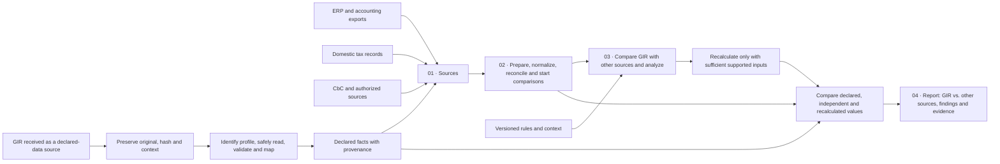

# P12 — Comparative analysis of the input GIR

**Language / Idioma:** [English (US)](P12-gir-input-review.md) · [Português (Brasil)](../P12-gir-entrada-conferencia.md)

Version `0.2.0-design`, October 23, 2026. **Requirement and contracts are specified; importer, XSD validation, executable analysis report and tax calculation are not implemented.** The JSON example is a synthetic internal contract. It is not an official GIR file and has not been validated against an OECD XSD. See [GIR source notes](gir-sources.md) and [ADR-005](../adr/ADR-005-gir-analise-comparativa.md).

## 1. Role in the project workflow

The received GIR is a declared-data source alongside ERP/accounting exports, domestic tax records, CbC reports and financial documents. It enters the same preparation and analysis chain. Its facts remain identifiable as declared; normalization and calculations never overwrite them.

| Stage | Function |
|---|---|
| **01 · Sources** | Receive authorized files and records, including a GIR supplied to the local operator. Preserve original bytes, context, source identity and hash. |
| **02 · Preparation** | Identify a supported profile; read and validate safely; map facts with provenance; normalize and reconcile comparable concepts; start GIR-to-source comparisons; report coverage and missing data. |
| **03 · Core** | Deepen the analysis of declared values against independent sources; run arithmetic checks; recalculate only when the applicable rule, engine profile and inputs are sufficient and sufficiently independent. |
| **04 · Results and use** | Produce an analysis report comparing the input GIR with the other sources, including comparisons, differences, insufficiencies, limits, calculation memory and evidence for human review. **The platform will not produce an output GIR.** |

This project does not receive filings from OECD or tax-authority systems. Local ingestion, institutional receipt, GIR content, exchange envelope and domestic filing requirements are separate boundaries. The analysis report is not a tax-authority filing or acceptance decision.

## 2. Ingestion and evidence requirements

The planned local ingestion contract is:

1. Record the operator-provided source, authorization context and ingestion time.
2. Preserve the exact original bytes; record byte length and SHA-256.
3. Identify format, namespace, message type and version when present.
4. Select an explicitly supported profile. Unknown profiles remain preserved and blocked.
5. Parse with resource limits and no DTD, external entities, XInclude or network schema resolution.
6. Validate structure against a locally pinned schema and validator version.
7. Run separately versioned semantic and consistency checks.
8. Map facts while retaining the original lexical value, locator, occurrence and context.
9. Report field coverage, unmapped material fields, errors and warnings.
10. Release only eligible facts to reconciliation or calculation.

The latest OECD schema must not be selected automatically for every file. A profile must account for the file, message, exchange purpose, applicable calendar and recipient requirements. The exact schema files and dependency hashes have not yet been acquired and pinned. Candidate versions are not supported profiles.

Absence, unknown, not applicable and reported zero are distinct states. Currency, unit, scale and sign are explicit. Monetary calculations must use exact decimal arithmetic; preserve the input lexeme and block values outside configured precision rather than silently rounding. Reprocessing the same bytes and context is idempotent. Distinct filing events remain distinct even when they contain identical bytes.

Proposed initial parser limits (not OECD limits): 10 MiB per file, depth 64, 100,000 elements and 1 MiB per text node; no compressed archives. Runtime and memory ceilings require measurement before release. Preserve rejected originals according to operator retention policy; if safe preservation is not possible, report that explicitly.

## 3. Internal data contracts

All IDs are internal and do not imply official OECD identifiers. Each record carries a schema version, classification, provenance and UTC record time. Tenant/organization scope applies to all keys and references.

| Entity | Key and cardinality | Required facts and integrity |
|---|---|---|
| `Submission` | Internal submission ID; links to documents, declared facts and relations | Context and profile status; source identifiers stored separately; unresolved period/entity prevents comparison. |
| `SourceDocument` | Document ID; linked to one or more submissions and facts | Authorized local locator, byte count, source, media/format state and SHA-256; bytes remain immutable. A hash does not prove authorship or acceptance. |
| `DeclaredFact` | Fact ID; belongs to a submission and source document | Concept, value state, original lexeme or reason for absence, locator, occurrence, context and materiality. Never invent an identifier or granularity. |
| `FieldMapping` | Mapping ID/version; maps source selectors to internal concepts | Profile, version, selector/namespaces, transformation and accepted states. A change creates a new mapping version and derived facts. |
| `ValidationResult` | Result ID; tied to document/submission and affected facts | Structure, semantic or consistency layer; rule/version, status, severity, scope and evidence. `not_executed` is never a pass. |
| `ReconciliationResult` | Result ID; relates facts from multiple sources | Join keys, source coverage, transformations and context. No match does not create a tax difference automatically. |
| `RecalculationRun` | Run ID; has an immutable input snapshot and versioned rules | Input sources, mode, profile, rule/package versions and status. Modes distinguish declared arithmetic, GIR-based inputs and independent sources. No output/hash when not executed. |
| `ComparisonResult` | Comparison ID; links declared facts and a run | Context, completeness, independence, values, exact differences, tolerance and evidence. Null values include an explicit reason. |
| `SubmissionRelation` | Relation ID; source submission and optional resolved target | Relation type, source reference, profile and affected scope. Invalid or unresolved references remain pending/rejected; upload time does not select the current filing. |

Provenance should recover, when available: document/hash, XML locator and namespace table or internal JSON Pointer, occurrence/context, original lexeme, transformation and mapping versions, entity, jurisdiction and period. Normalized values are immutable derivatives. Recalculated values use an independently identified input snapshot and cannot feed their own declared reference.

## 4. Reconciliation and comparison

Each check records an ID, purpose, required fields, sources, rule/version, grain, applicability, expected result, limitations and evidence. Candidate checks include identity/period/currency, totals and subtotals, arithmetic relationships, elections, and declared-versus-recalculated values. Exact XML selectors, cardinalities and rule conditions remain unapproved until verified against a supported profile.

Valid result states include `consistent_in_scope`, `divergent`, `not_comparable`, `insufficient_data`, `unsupported_rule` and `not_applicable`. A check not run has `execution_status=not_executed` and a null result. Partial coverage cannot be presented as a global pass.

The comparison preserves `recalculated - declared`, its absolute value, currency, scale and context. Relative difference is calculated only with a valid nonzero denominator. Tolerances are justified and versioned; the exact amount remains available. Potential causes (rounding, FX, period/perimeter, adjustments, elections, rule version, correction or mapping) are hypotheses for review, not conclusions of misconduct.

ERP, consolidation, current/deferred tax, corporate structure, CbC and domestic records such as Brazil's ECD/ECF need explicit keys, grain, coverage, concept bridges, period, currency, adjustment and access limits. Accounting profit, taxable profit, GloBE income and CbC profit are not presumed equivalent.

## 5. Corrections, security and delivery plan

Preserve every submission and prior execution. Resolve corrections only under a verified profile; support partial replacements and as-of views with explicit snapshots. Never choose the current declaration solely by latest upload. Conflicting successors or unresolved references block the affected view; old calculations remain reproducible.

Only synthetic data belongs in the repository, tests and public site. Logs contain no tax-return contents. Local processing is the initial scope; multi-organization access requires segregation and operator-defined retention. Do not send real GIR files to AI or external APIs by default.

| Increment | Acceptance focus | Status |
|---|---|---|
| GIR-0 | Contracts, sources, coverage and synthetic design example | Specified in this delivery; not an importer |
| GIR-1 | Secure reader for one fixed profile/schema; repeat-ingestion idempotence and hostile XML rejection | Planned; schema artifacts and profile selection are prerequisites |
| GIR-2 | Field mapping, declared/normalized facts and provenance | Planned; selectors and mapping review required |
| GIR-3 | Internal consistency checks and independent expected cases | Planned; unsupported conditions remain blocked |
| GIR-4 | Compare with an already supported calculation profile | Planned; requires adequate independent inputs and no circularity |
| GIR-5 | Correction history and reproducible as-of views | Planned; correction semantics must match supported messages |
| GIR-6 | External reconciliations and review reports | Planned; authorized adapters and access are required |

Minimum future test cases cover: same-file reprocessing; unsupported version; DTD/XXE; missing or unmapped material fields; incompatible period/currency; invalid correction references; insufficient recalculation inputs; exact comparison differences; reproducible prior runs; and absence of real data in logs/public artifacts. A fixture may be called XSD-valid only after that validation actually ran.

## 6. Sources, known gaps and next step

The [English source register](gir-sources.md) records official publications, version notes and remaining questions. The official XSDs are not pinned locally; mappings, domestic receipt requirements, parser ceilings and some exchange-calendar boundaries remain open. No source establishes institutional adoption or connection for this project.

Next proposed increment: [GIR-1 execution prompt](../../prompts/execucao-GIR1.md). It must stop schema-dependent claims if the relevant files cannot be obtained and fixed, while completing independent preservation and diagnostics work.
